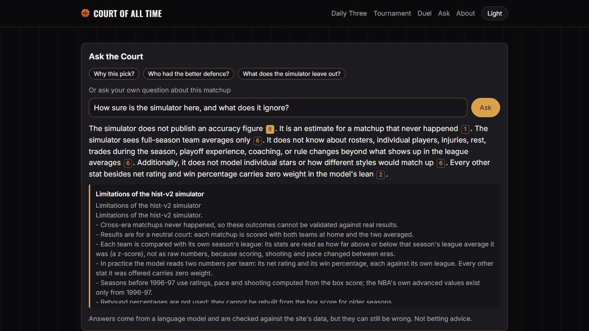
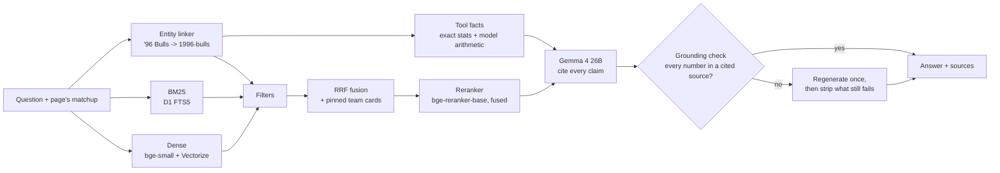

# Ask the Court: grounded question answering over 40 NBA seasons

Ask the Court is the question box on [Court of All Time](https://courtofalltime.win), a simulator that estimates who
would win between NBA team-seasons from different eras. A visitor asks *"Why does the model favour the '17 Warriors
over the '96 Bulls?"* or *"Who had the best defence of the 1990s?"* and gets a short answer that cites the site's own
data. Every number in the answer is checked against the source it cites before the visitor sees it.

It is a retrieval-augmented generation (RAG) system built to be **measured, not demoed**. Every component was added
one at a time against a fixed evaluation set, with a held-out test split, and the parts that didn't help are reported
too. It runs entirely on Cloudflare's free allowances.

*The panel on staging, answering from the deployed Worker. Each numbered button opens the source it cites.*

## Results on the held-out test split

| What | Result |
|---|---|
| Retrieval recall@5 | **0.948**, up from 0.643 (BM25) and 0.789 (dense embeddings) |
| Answers with every expected number right | **0.771** (Gemma 4), against 0.686 (Qwen3) and 0.600 (Llama 3.1 8B) |
| Answers that pass the grounding check | **100%** after one regeneration (99% on the first try) |
| Out-of-scope prompts refused (betting, live games, prompt injection) | **8 of 8**; 4.5% of answerable questions wrongly refused |
| Deployed Worker against the Python reference | Same numbers-right (0.771), recall (0.948) and refusals (1.000) |
| Cost | About 29 neurons an answer, so **about 270 free answers a day**, $0 |

The evaluation set has 245 questions: 147 for development, 98 held out. 175 are generated from the data, so their
expected answers are exact; 70 are written by hand (method questions, questions that need several facts, and 25
adversarial ones). Configurations were chosen on the development split, and the test split was scored once per
reported configuration. The full tables, the ablations and every failure pattern are in
[`reports/rag_evaluation.md`](../../reports/rag_evaluation.md).

## How it works

Each part answers a failure a plain RAG system has on this data:

| Part | The failure it fixes | What it measured (test) |
|---|---|---|
| **Entity linker** | "'96 Bulls", "1995–96 Bulls" and "Bulls 1996" are one team-season. To an embedding, 2003–04 and 2004–05 look alike | Filters and pinned cards: recall@5 from 0.783 to **0.948** |
| **Tool facts** | Models misread numbers from long text. The facts give stats and the model's exact arithmetic in one line each | Without them, numbers-right drops 5.7 points (16 on dev) |
| **Hybrid retrieval** | Keyword search wins on names and years, dense on paraphrase | Only helps with the linker's filters; reported as such |
| **Reranker, fused** | Replacing the order with the reranker's put team cards above the leaderboards rankings need (0.881) | Fusing it by RRF won on dev, tied on test; kept for +5.5 points on answers |
| **Grounding check** | Prompts don't stop a model adding a number | 100% of answers grounded; failures regenerate, then get stripped |
| **Betting check** | Two cheaper models answered "set a line" with a margin | Refused before any model call |

**The model's real arithmetic.** The simulator is an L1 logistic regression that, after folding its scaler, is
`logit = 0.360 + 0.356 × Δ net-rating z + 0.129 × Δ win-% z`. That reproduces 2,000 of 2,000 sampled published win
probabilities exactly. So "why" answers quote each input's actual share of the model's lean, not a plausible story.

## What was measured and dropped

- **bge-base (768 dimensions) lost to bge-small (384)**, with or without BGE's recommended query instruction.
- **Splitting each team card into two chunks** lost on dev.
- **Llama 3.2 3B** refused 54% of answerable questions.
- **3 chunks instead of 5** is 24% cheaper but slightly worse; it's the fallback if the budget gets tight.
- **The LLM judge is unvalidated.** Without human labels to check it against, its faithfulness scores are reported
  as a secondary signal, and every choice rests on the rule-based metrics.

## Production

It runs on the site's existing Cloudflare Worker:

- **Workers AI** for the three models: bge-small embeddings, the bge reranker and Gemma 4.
- **Vectorize** for dense search over 1,305 chunks.
- **D1 FTS5** for BM25. It's a separate database: D1 can't export FTS5 tables, and the site's backups are exports.
- **KV** for the corpus, read once per isolate.

**Guards:** per-IP limits, a kill switch, and a daily neuron budget (8,000 of the free 10,000). Once the budget is
spent, the suggested questions still answer from templates, with no model.

**Port and parity.** The Python reference was ported to TypeScript. Parity tests hold the port to it on 245
questions, 192 real model answers and 36 matchups.

**Free.** All development ran on Workers AI too: about 44,000 neurons over 9 days, each day inside the free
allowance, behind a response cache and a daily cap in the client.

## Where it still fails

Rankings are the weak spot: half of the ranking questions name the wrong leader or don't give the number expected.
Some comparisons name the wrong team despite citing the right z-scores. Some "why" answers leave out the chance
itself. These are listed one by one in the report, with the prompt fixes to try next.

## Code

| Part | Where |
|---|---|
| Corpus, model inputs | `scripts/build_rag_corpus.py`, `src/rag/corpus.py` |
| Linker, retrieval, tools, generation, grounding (Python reference) | `src/rag/` |
| Evaluation set and harness | `src/rag/eval/`, `scripts/eval_rag.py`, `tests/fixtures/rag/` |
| Worker route and port | `worker/src/ask/`, `worker/test/ask*.test.ts` |
| Panel | `frontend/src/components/ask/AskPanel.tsx`, `frontend/src/lib/askApi.ts` |
| Plan and session records | [`docs/product/features/F13-ask-the-court.md`](../product/features/F13-ask-the-court.md) |
